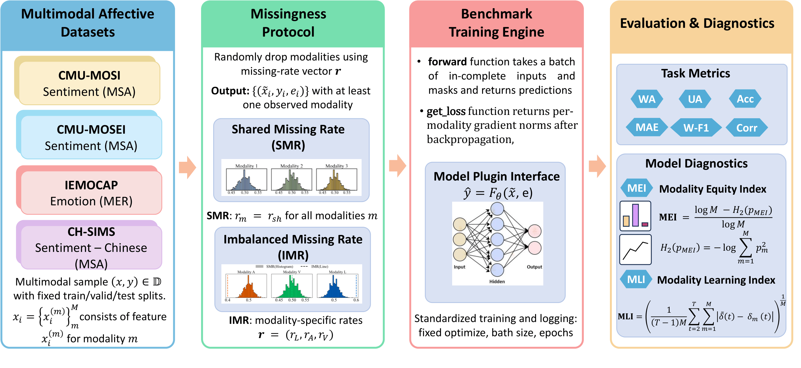

# MissBench: Benchmarking Multimodal Affective Analysis under Imbalanced Missing Modalities

This repository contains the official PyTorch implementation for MissBench. It provides a unified pipeline for training and evaluating multimodal methods under missing modality scenarios.

<div align="center"> 

</div>

## Code Structure

```text
MissBench/
├── config/
│   ├── base_config.py    # Common arguments
│   ├── config_manager.py # Configuration loader
│   └── [model]_config.py # Model-specific configurations
├── data/
│   ├── con_dataset.py    # Conversational dataset loader
│   ├── noncon_dataset.py # Non-conversational dataset loader
│   └── ...
├── models/
│   ├── __init__.py       # Model interface
│   ├── encoder.py        # Specific encoder
│   ├── loss.py           # Objective function
│   └── ...
├── utils/                # Utility functions (logger, metrics)
├── train.py              # Main training script
├── eval.py               # Evaluation script
└── eval_balance.py       # MEI and MLI evaluator
```

## Dependencies

- Python 3.8+
- PyTorch
- NumPy, Scikit-learn
- Comet_ml (optional)

Install requirements via:

```
pip install -r requirements.txt
```

## Datasets

Please download the datasets from [Google Drive](https://drive.google.com/drive/folders/1o8rbIXkow8u6WE9fDU9ZkkFsdoMmGeXg?usp=drive_link) and place them in the `data/` directory.

## Hyperparameter Settings

Below are the core optimization hyperparameters used across all experiments:

| Argument       |      Default      | Description                                                                         |
| :------------- | :---------------: | :---------------------------------------------------------------------------------- |
| `base_model`   |      `None`       | Name of the model to train (e.g., `redcore`, `gcnet`).                              |
| `dataset`      |     `iemocap`     | Target dataset (`iemocap`, `mosi`, `mosei`, `sims`).                                |
| `dataset_mode` |       `con`       | `con` (Conversational) or `noncon` (Non-conversational) dataset loader.             |
| `modal_MR`     | `[0.0, 0.0, 0.0]` | Missing Rate for [Audio, Visual, Language]. Example: `0.5 0.0 0.0`.                 |
| `batch_size`   |   `16` / `128`    | **16** for conversational (`con`), **128** for non-conversational (`noncon`) model. |
| `lr`           |      `2e-4`       | Learning rate.                                                                      |
| `epochs`       |       `50`        | Total training epochs.                                                              |
| `early_stop`   |       `10`        | Number of epochs for early stopping.                                                |
| `MLI`          |      `False`      | Enable MLI evaluation.                                                              |
| `MEI`          |      `False`      | Enable MEI evaluation.                                                              |

## Usage

We provide shell scripts in the `scripts/` directory to run our benchmarks easily.

**Example: Running benchmarks for `ada2i`:**

```bash
# Run Shared Missing Rate (SMR) experiment
bash scripts/ada2i/ada2i-smr.sh

# Run Imbalanced Missing Rate (IMR) experiment
bash scripts/ada2i/ada2i-imr.sh
```

## Citation

If you find our work useful, please consider citing it.
